<h1 align="center">Hey, I'm Cle 👋</h1>

  

  
  
  
  
  
  

---

### ⚡ Recent activity

  

### 📈 Contribution calendar

  

### 🗓️ Latest contributions (newest first)

<!--START_SECTION:feed-->
**66** contributions in the last 30 days · **22** in the last 7 days

| Date | | Contributions | |
|:--|:--|:--|:--|
| Oct 28 | Wed | 🟩🟩 **2** | 🌱 steady |
| Oct 27 | Tue | 🟩🟩🟩🟩🟩🟩 **6** | 🔥 big day |
| Oct 26 | Mon | 🟩 **1** | 🌱 steady |
| Oct 23 | Fri | 🟩🟩🟩🟩🟩🟩🟩🟩🟩🟩➕ **11** | 🚀 on fire |
| Oct 22 | Thu | 🟩🟩 **2** | 🌱 steady |
| Oct 16 | Fri | 🟩🟩🟩 **3** | ⚡ solid |
| Oct 15 | Thu | 🟩🟩🟩🟩 **4** | ⚡ solid |
| Oct 14 | Wed | 🟩🟩🟩🟩🟩 **5** | 🔥 big day |
| Oct 12 | Mon | 🟩 **1** | 🌱 steady |
| Oct 09 | Fri | 🟩🟩🟩 **3** | ⚡ solid |
| Oct 08 | Thu | 🟩🟩🟩 **3** | ⚡ solid |
| Oct 06 | Tue | 🟩 **1** | 🌱 steady |
| Oct 05 | Mon | 🟩🟩🟩 **3** | ⚡ solid |
| Oct 02 | Fri | 🟩 **1** | 🌱 steady |

Updated 2026-10-28 04:40 UTC
<!--END_SECTION:feed-->

### 👾 Pac-Man eats my contributions

<picture>
  <source media="(prefers-color-scheme: dark)" srcset="https://raw.githubusercontent.com/cle-trinidad/cle-trinidad/output/pacman-contribution-graph-dark.svg" />
  <source media="(prefers-color-scheme: light)" srcset="https://raw.githubusercontent.com/cle-trinidad/cle-trinidad/output/pacman-contribution-graph.svg" />
  
</picture>

---

<i>Activity and Pac-Man refresh automatically every 6 hours.</i>

